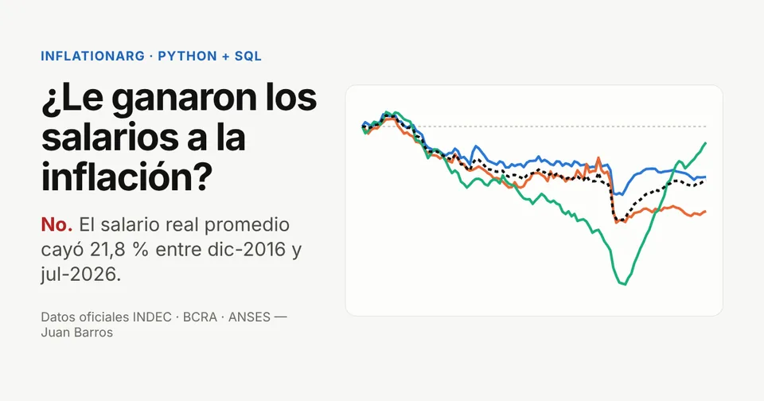
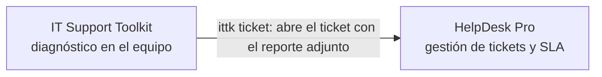

<div align="center">

# Juan Barros

**Analista de Datos Trainee/Junior · SQL · Python · Excel · QA de datos**

Estudiante de la Tecnicatura en Desarrollo de Software y de la Licenciatura en Gestión de Tecnología de la Información (UADE).
Experiencia en soporte técnico y mesa de ayuda universitaria, y en ventas.

Caballito, CABA · Modalidad presencial, híbrida o remota · [juanmbarrosf@gmail.com](mailto:juanmbarrosf@gmail.com) · [LinkedIn](https://www.linkedin.com/in/barrosjuan0)

### 🌐 [juanmbf.github.io/Portfolio](https://juanmbf.github.io/Portfolio/)

[](https://github.com/JuanMBF/Portfolio/actions/workflows/sitio.yml)
[](https://github.com/JuanMBF/Portfolio/actions/workflows/helpdesk-pro.yml)
[](https://github.com/JuanMBF/Portfolio/actions/workflows/mongo-replica-lab.yml)
[](https://github.com/JuanMBF/Portfolio/actions/workflows/it-support-toolkit.yml)

</div>

---

## Proyecto principal: [InflationArg](https://github.com/JuanMBF/InflationArg)

**¿Le ganaron los salarios a la inflación en Argentina? (2016–2026)** · [Sitio y dashboard en vivo](https://juanmbf.github.io/InflationArg/)

[](https://juanmbf.github.io/InflationArg/)

**No.** Con datos oficiales (INDEC, BCRA, ANSES) a julio de 2026, el salario real promedio quedó 21,8 % por debajo de diciembre de 2016, y el del sector público, 34,3 %.

- **Pipeline en Python** que corre de punta a punta con un comando y sin internet: descarga verificada con sha256, base SQLite, Excel, modelo para Power BI y sitio web.
- **SQL:** modelo estrella, vistas con CTEs y window functions (`LAG`, `RANK`, acumulados) y una consulta comentada por pregunta de negocio.
- **QA de datos:** 11 chequeos automáticos que encontraron anomalías reales en las fuentes oficiales (series vacías en la API, un valor repetido del RIPTE, valores fechados a futuro).
- **Para RR.HH.:** calculadora de ajuste salarial, con la misma lógica en Python y JavaScript probada con los mismos casos.
- **Calidad:** pytest con 99 % de cobertura, validación HTML y auditoría de accesibilidad con Playwright + axe en CI.

## Otros proyectos en este repositorio

Tres proyectos alrededor del trabajo de soporte IT: **diagnosticar** el problema en el equipo del usuario, **gestionarlo** como ticket con tiempos de respuesta y **mantener disponible** la infraestructura de datos. El toolkit y HelpDesk Pro están integrados:



### [HelpDesk Pro](helpdesk-pro): sistema de mesa de ayuda full stack


Sistema de tickets de soporte IT con **SLA por prioridad**, **roles** (usuario, técnico y administrador), **notas internas**, **historial de auditoría** y **dashboard de métricas**. Está inspirado en el trabajo de una mesa de ayuda universitaria: incidencias con el campus virtual, videoconferencias, redes y hardware de aulas.

- **Backend:** Java 21, Spring Boot 3, Spring Security con JWT, JPA/Hibernate, MySQL, OpenAPI/Swagger.
- **Frontend:** React 18, Vite y React Router, con componentes y gráficos propios, modo oscuro y diseño responsive.
- **Calidad:** 96 tests (JUnit + MockMvc, Vitest + Testing Library), errores con formato RFC 7807 y bloqueo optimista.
- **Infraestructura:** Docker Compose (MySQL + API + nginx) y CI que levanta el stack completo en cada push.

`docker compose up --build` y entrás con un clic usando las cuentas de demo → [ver proyecto](helpdesk-pro)

### [Mongo Replica Lab](mongo-replica-lab): alta disponibilidad con MongoDB

Replica set de 3 nodos en Docker con herramientas en Python que **replican 10.000 registros**, verifican con una huella (hash) que todos los nodos tengan exactamente los mismos datos y **matan el nodo primario mientras una aplicación escribe** para medir la recuperación.

| Escenario | Tiempo hasta nuevo primario | Corte visto por la app | Escrituras confirmadas perdidas |
|---|---|---|---|
| Caída abrupta (`docker compose kill`) | 7,99 s | 10,05 s | **0** |
| Cambio planificado (`replSetStepDown`) | 0,15 s | 0,05 s | **0** |

- **Stack:** MongoDB 7, Docker Compose, Python, PyMongo y Bash.
- La prueba de caída corre en GitHub Actions en cada push → [ver proyecto](mongo-replica-lab)

### [IT Support Toolkit](it-support-toolkit): diagnóstico de soporte desde la terminal

CLI en Python que releva el equipo (CPU, RAM, discos, IPs), prueba la red en paralelo e **interpreta los resultados como un técnico** ("hay conexión pero falla el DNS", "posible proxy bloqueando la navegación"). Genera reportes en Markdown, HTML o JSON y **abre el ticket en HelpDesk Pro** con el diagnóstico adjunto.

```text
$ ittk netcheck
Pruebas de conectividad
  ✔ DNS            www.google.com                            5 ms  resuelve a 142.251.157.119
  ✘ Internet (IP)  8.8.8.8:53                                      sin respuesta (timeout): posible firewall
  ✔ HTTPS          www.google.com:443                        5 ms  conexión aceptada
  ✘ HTTP           https://www.google.com/generate_204             sin respuesta (Tunnel connection failed: 403 Forbidden)

Diagnóstico
  ⚠ La conexión directa funciona pero la navegación web falla
    → Posible proxy que bloquea el sitio o pide autenticación: revisar la configuración de proxy.
```

- **Stack:** Python, psutil, argparse y la librería estándar (sockets, urllib, concurrent.futures).
- 42 tests y CI configurado para Windows, Linux y macOS → [ver proyecto](it-support-toolkit)

### Más proyectos en otros repositorios

| Proyecto | Qué es | Stack |
|---|---|---|
| [ProyectoDB](https://github.com/JuanMBF/ProyectoDB) | Scraper de precios de Coto, Día y Carrefour: guarda el historial en MySQL, archiva las respuestas crudas en un replica set de MongoDB y compara precios con SQL (vistas con *window functions*). | Python · MySQL · MongoDB · SQLAlchemy · Alembic |
| [HelpDesk Pro en Python](https://github.com/JuanMBF/python) | Sistema de tickets de soporte IT con API REST, autenticación JWT, SLA por prioridad y panel de métricas. | Python · FastAPI · SQLAlchemy · Streamlit · pytest |

---

## Tecnologías

| Área | Tecnologías |
|---|---|
| Datos | SQL (CTEs, window functions) · Python · pandas · Excel avanzado (tablas dinámicas, macros) · QA de datos |
| Lenguajes | Python · SQL · JavaScript · Java |
| Backend | Spring Boot · Spring Security · JPA/Hibernate · FastAPI · SQLAlchemy · API REST · JWT |
| Frontend | React · Vite · HTML · CSS |
| Bases de datos | MySQL · SQLite · MongoDB (replica sets) · modelo estrella · H2 |
| Testing | JUnit 5 · MockMvc · Vitest · Testing Library · pytest |
| DevOps | Docker · Docker Compose · GitHub Actions · nginx · Git |
| Soporte IT | Diagnóstico de redes (DNS, TCP, HTTP) · relevamiento de equipos · gestión de incidencias y SLA |

## Sitio del portfolio

La carpeta [`sitio/`](sitio) es el sitio publicado en [juanmbf.github.io/Portfolio](https://juanmbf.github.io/Portfolio/): HTML y CSS hechos a mano, modo claro y oscuro, sin cookies ni rastreadores. En cada cambio, [`sitio.yml`](.github/workflows/sitio.yml) valida el HTML y corre una auditoría de accesibilidad con Playwright + axe en 375, 768 y 1280 px (claro y oscuro) antes de publicarlo en la rama `gh-pages`.

```bash
cd sitio-tests && npm ci && npx playwright install chromium
npm run validar-html && npm run qa
```

## Correr los proyectos

Cada proyecto tiene su propio README con instrucciones detalladas. Para probarlos rápido, desde la carpeta del repo:

```bash
git clone https://github.com/JuanMBF/Portfolio.git
cd Portfolio
```

| Proyecto | Comando | Requisitos |
|---|---|---|
| HelpDesk Pro | `cd helpdesk-pro && docker compose up --build` → http://localhost:3000 | Docker |
| Mongo Replica Lab | `cd mongo-replica-lab && make up && make load && make crash` | Docker |
| IT Support Toolkit | `cd it-support-toolkit && pip install . && ittk netcheck` | Python 3.10+ |

## Contacto

📧 [juanmbarrosf@gmail.com](mailto:juanmbarrosf@gmail.com) · 📍 Caballito, CABA, Argentina · Español nativo, inglés intermedio (B1)
