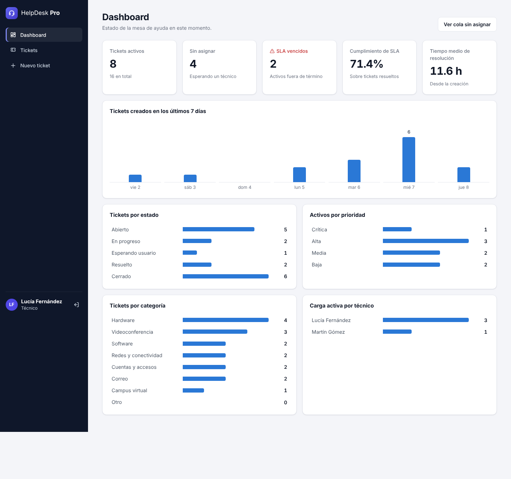
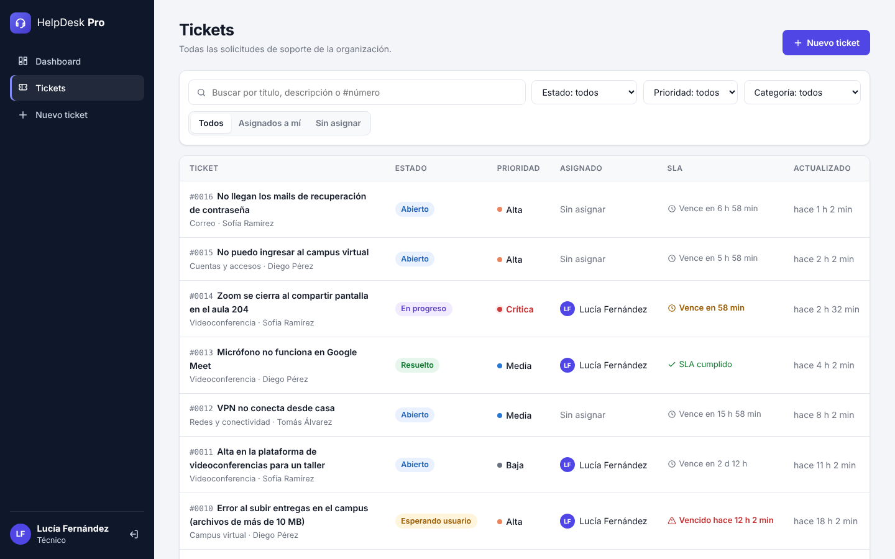
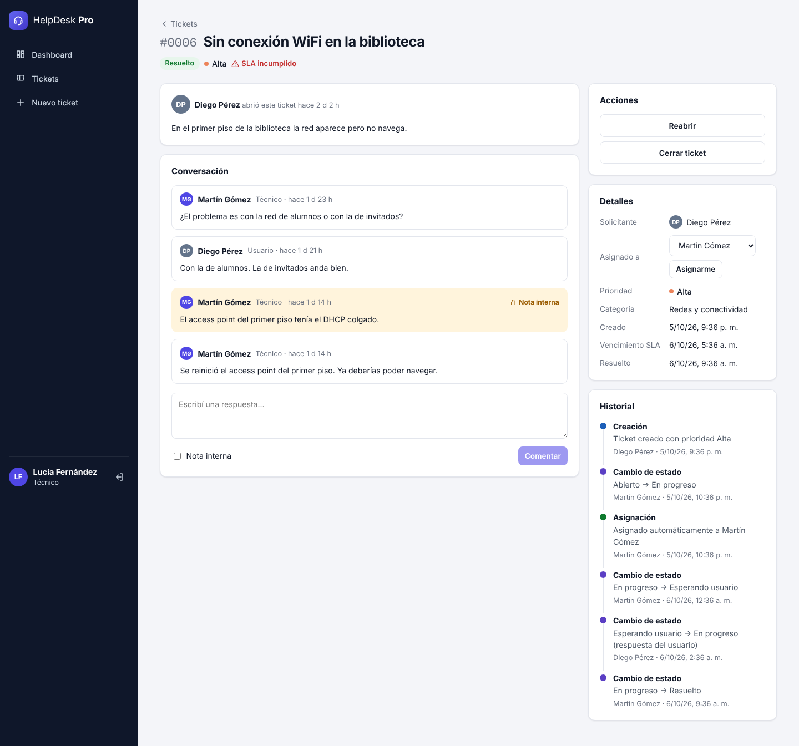
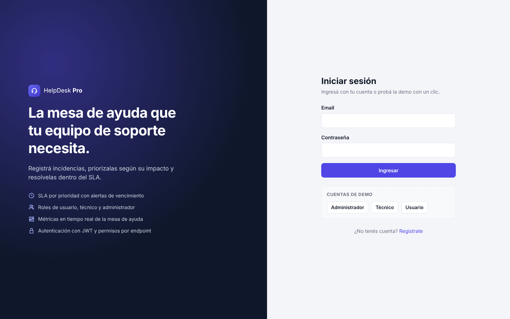
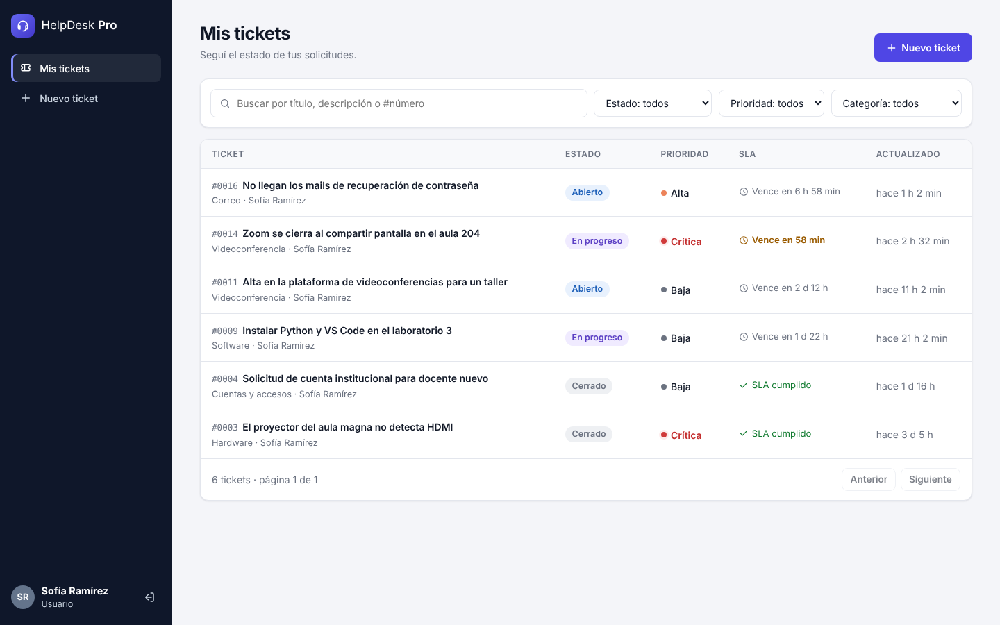
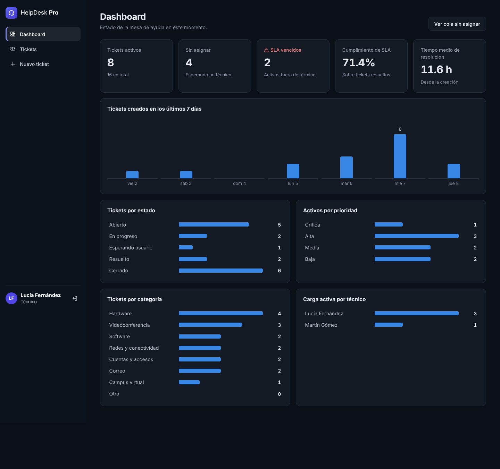
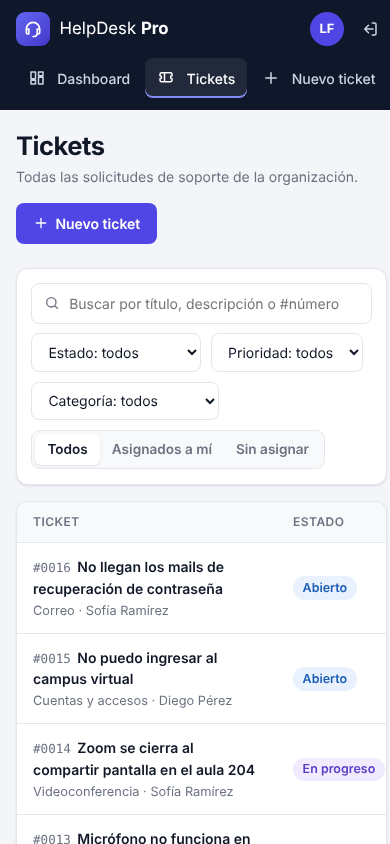
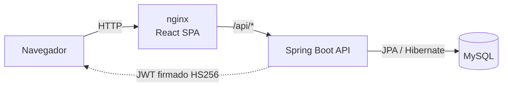
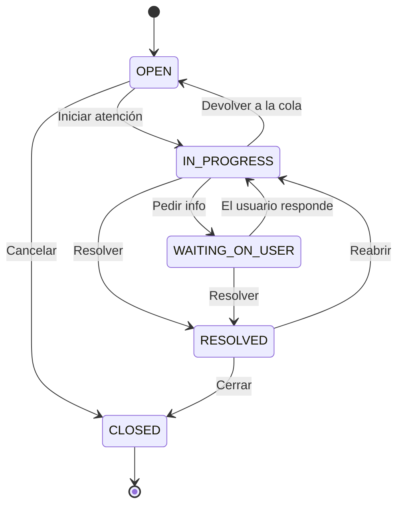

# HelpDesk Pro

Sistema de **mesa de ayuda (help desk)** para gestionar incidencias de soporte IT, con **SLA por prioridad**, **roles**, **historial de auditoría** y un **dashboard de métricas**.

Está inspirado en mi experiencia en la mesa de ayuda de la Universidad Nacional Guillermo Brown: problemas con el campus virtual, videoconferencias que se caen en plena clase, proyectores sin señal. La idea fue modelar ese trabajo diario como un sistema completo: cómo entra un pedido, quién lo toma, cuánto tiempo hay para resolverlo y qué pasó en cada paso.




---

## Qué hace

| Rol | Puede |
|---|---|
| **Usuario** | Crear tickets, seguir el estado de los suyos y responder a los técnicos. |
| **Técnico** | Ver todos los tickets, tomarlos, cambiar estado y prioridad, reasignar y dejar **notas internas**. |
| **Administrador** | Todo lo anterior y además gestionar los roles de los usuarios. |

**Funcionalidades destacadas**

- **SLA por prioridad**: Crítica 4 h · Alta 8 h · Media 24 h · Baja 72 h. Cada ticket muestra cuánto le queda o hace cuánto venció.
- **Flujo de estados controlado**: el backend solo permite transiciones válidas (por ejemplo, no se puede resolver un ticket que nadie empezó).
- **Asignación automática**: cuando un técnico inicia un ticket sin dueño, queda asignado a él.
- **"Esperando al usuario"**: cuando el usuario responde, el ticket vuelve solo a *En progreso*.
- **Notas internas** que el usuario final nunca ve (filtradas en el backend, no solo ocultas en la UI).
- **Historial de auditoría**: quién cambió qué y cuándo.
- **Búsqueda y filtros** por texto, número (`#12`), estado, prioridad, categoría y "asignados a mí" / "sin asignar", con paginación. Los filtros viven en la URL.
- **Dashboard**: tickets activos, sin asignar, SLA vencidos, % de cumplimiento, tiempo medio de resolución, tendencia de 7 días y carga por técnico.
- **Modo oscuro** automático y diseño responsive.

## Capturas

| Listado de tickets (técnico) | Detalle con conversación e historial |
|---|---|
|  |  |

| Login con cuentas de demo | Vista de usuario final |
|---|---|
|  |  |

| Modo oscuro | Mobile |
|---|---|
|  |  |

## Arquitectura



**Backend** (`backend/`): Java 21 + Spring Boot 3.3, organizado por funcionalidad (`auth`, `ticket`, `user`, `dashboard`, `security`).

- **Spring Security** sin sesiones (stateless) con **JWT** propio (librería jjwt) y contraseñas con **BCrypt**.
- Permisos con `@PreAuthorize` por endpoint, más reglas de visibilidad en el servicio (un usuario recibe **404** al pedir un ticket ajeno, para no revelar que existe).
- **Spring Data JPA** con `Specification` para filtros combinables y `@EntityGraph` para evitar el problema N+1 en el listado.
- **Bloqueo optimista** (`@Version`): si dos técnicos editan el mismo ticket a la vez, el segundo recibe un 409 en lugar de pisar el cambio.
- Errores con formato estándar **RFC 7807** (`application/problem+json`) y validación con Bean Validation.
- Reglas de negocio dentro de la entidad (`Ticket.changeStatus`, `isSlaBreached`) para testearlas sin levantar Spring.
- Documentación **OpenAPI / Swagger UI** generada automáticamente.

**Frontend** (`frontend/`): React 18 + Vite + React Router, sin librerías de UI: componentes, íconos y gráficos hechos a mano con CSS.

### Ciclo de vida del ticket



## Cómo correrlo

### Opción 1: Docker (recomendada)

```bash
cd helpdesk-pro
docker compose up --build
```

| Servicio | URL |
|---|---|
| App web | http://localhost:3000 |
| API | http://localhost:8080/api |
| Swagger UI | http://localhost:8080/swagger-ui.html |

### Opción 2: Local, sin Docker

Requisitos: Java 21 y Node 20 o superior. El backend usa **H2 en memoria** por defecto, así que no hace falta instalar una base de datos.

```bash
# Terminal 1: API en http://localhost:8080
cd helpdesk-pro/backend
./mvnw spring-boot:run

# Terminal 2: frontend en http://localhost:5173 (las llamadas a /api se redirigen al backend)
cd helpdesk-pro/frontend
npm install
npm run dev
```

### Cuentas de demo

Al iniciar por primera vez se cargan 6 usuarios y 16 tickets de ejemplo, con SLA cumplidos, vencidos y en curso. En el login hay botones para entrar con un clic.

| Rol | Email | Contraseña |
|---|---|---|
| Administrador | `admin@helpdesk.dev` | `Admin123!` |
| Técnico | `lucia@helpdesk.dev` | `Agent123!` |
| Técnico | `martin@helpdesk.dev` | `Agent123!` |
| Usuario | `sofia@helpdesk.dev` | `User123!` |

## API

| Método | Endpoint | Quién | Descripción |
|---|---|---|---|
| `POST` | `/api/auth/register` | Público | Crea una cuenta (rol USER) y devuelve un JWT |
| `POST` | `/api/auth/login` | Público | Devuelve un JWT |
| `GET` | `/api/auth/me` | Autenticado | Usuario actual |
| `GET` | `/api/tickets` | Autenticado | Listado con filtros `status`, `priority`, `category`, `q`, `mine`, `unassigned`, `page`, `size`, `sort` |
| `POST` | `/api/tickets` | Autenticado | Crea un ticket |
| `GET` | `/api/tickets/{id}` | Autenticado | Detalle |
| `PATCH` | `/api/tickets/{id}/status` | Técnico | Cambia el estado (valida la transición) |
| `PATCH` | `/api/tickets/{id}/priority` | Técnico | Cambia la prioridad y recalcula el SLA |
| `PATCH` | `/api/tickets/{id}/assignee` | Técnico | Asigna o desasigna |
| `GET` | `/api/tickets/{id}/comments` | Autenticado | Comentarios (las notas internas solo para el staff) |
| `POST` | `/api/tickets/{id}/comments` | Autenticado | Agrega un comentario o nota interna |
| `GET` | `/api/tickets/{id}/events` | Autenticado | Historial de auditoría |
| `GET` | `/api/dashboard` | Técnico | Métricas agregadas |
| `GET` | `/api/users` | Admin | Lista de usuarios |
| `PATCH` | `/api/users/{id}/role` | Admin | Cambia el rol |

Ejemplo con `curl`:

```bash
TOKEN=$(curl -s -X POST localhost:8080/api/auth/login \
  -H 'Content-Type: application/json' \
  -d '{"email":"lucia@helpdesk.dev","password":"Agent123!"}' | jq -r .token)

curl -s "localhost:8080/api/tickets?status=OPEN&priority=HIGH" -H "Authorization: Bearer $TOKEN" | jq
```

## Tests

```bash
(cd backend && ./mvnw verify)                 # 70 tests: unitarios + integración con MockMvc y H2
(cd frontend && npm install && npm test)      # 31 tests: utilidades, componentes, Markdown y login con Vitest + Testing Library
```

Los tests de integración levantan la aplicación completa y verifican, entre otras cosas:

- que un usuario **no pueda ver ni comentar tickets ajenos** (404) ni cambiar estados (403);
- que una transición inválida devuelva **409** con un mensaje claro;
- que las **notas internas no lleguen** al usuario final;
- que la respuesta del usuario saque al ticket de *Esperando usuario*;
- que el dashboard agregue bien estados, prioridades, SLA y carga por técnico.

La cobertura del backend es del **78 % de las instrucciones** (JaCoCo). El reporte queda en `backend/target/site/jacoco/index.html` y el CI lo publica como artefacto en cada corrida.

## Estructura

```
helpdesk-pro/
├── backend/
│   └── src/main/java/com/juanbarros/helpdesk/
│       ├── auth/          # registro, login, /me
│       ├── ticket/        # entidad, reglas de negocio, filtros, comentarios, historial
│       ├── user/          # usuarios y roles
│       ├── dashboard/     # métricas agregadas
│       ├── security/      # JWT, filtro, configuración de Spring Security
│       ├── config/        # datos de demo, OpenAPI, reloj inyectable
│       └── common/        # manejo global de errores, paginación
├── frontend/
│   └── src/
│       ├── api/           # cliente HTTP con manejo de errores RFC 7807
│       ├── auth/          # contexto de autenticación
│       ├── components/    # badges, gráficos, layout, paginación
│       └── pages/         # login, tickets, detalle, dashboard, usuarios
└── docker-compose.yml     # MySQL + API + nginx
```

## Próximos pasos

- Notificaciones por email al cambiar el estado de un ticket.
- Adjuntar capturas de pantalla a los tickets.
- Pausar el reloj del SLA mientras el ticket espera al usuario.
- Migraciones de base de datos con Flyway.
