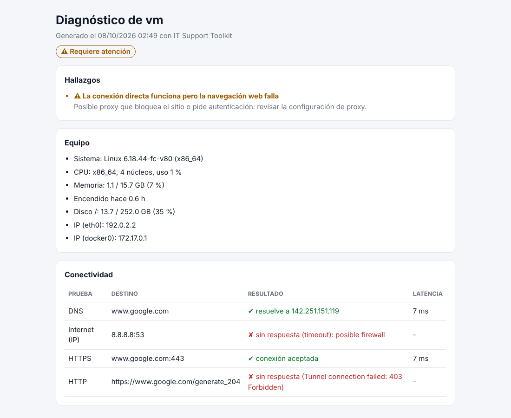
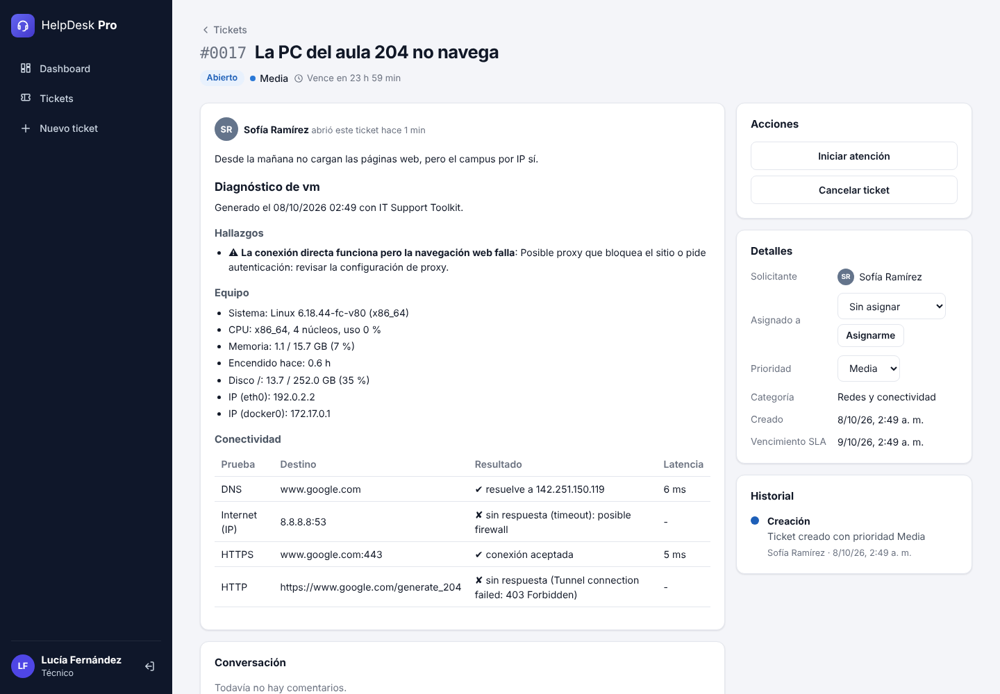

# IT Support Toolkit (`ittk`)

Herramienta de línea de comandos para **mesa de ayuda**: en segundos releva el equipo, prueba la conexión, **interpreta los resultados como lo haría un técnico** y genera un reporte listo para adjuntar a un ticket. Incluso puede **abrir el ticket directamente en [HelpDesk Pro](../helpdesk-pro)**.

La idea es que el técnico reciba desde el primer momento la información que normalmente tiene que pedir (qué equipo es, cómo están sus recursos y qué falla en la red) sin depender de que el usuario la sepa describir.


## Comandos

| Comando | Qué hace |
|---|---|
| `ittk sysinfo` | Sistema operativo, CPU, RAM, discos, IPs y tiempo encendido, con alertas (disco casi lleno, RAM saturada, muchos días sin reiniciar). |
| `ittk netcheck` | Prueba DNS, conexión por IP, HTTPS y navegación web **en paralelo** y da un diagnóstico. |
| `ittk ports HOST` | Verifica qué servicios responden en un servidor (SSH, HTTPS, MySQL, escritorio remoto…). |
| `ittk report` | Reporte completo en Markdown, HTML o JSON. |
| `ittk ticket` | Abre un ticket en HelpDesk Pro con el diagnóstico adjunto y sugiere categoría y prioridad. |

Todos devuelven **códigos de salida** útiles para scripts y monitoreo: `0` todo OK, `1` advertencias, `2` problemas críticos.

## Instalación

```bash
cd it-support-toolkit
pip install .            # o: pip install -e ".[dev]" para desarrollo
ittk --help
```

Única dependencia: [`psutil`](https://github.com/giampaolo/psutil), para leer los recursos del equipo en cualquier sistema operativo.

## Ejemplos reales

### Diagnóstico de red

El diagnóstico no se queda en "falló / no falló": cruza los resultados para sugerir la causa. Esta salida es de una red real que sale a internet a través de un proxy:

```text
$ ittk netcheck
Pruebas de conectividad
  ✔ DNS            www.google.com                            5 ms  resuelve a 142.251.157.119
  ✘ Internet (IP)  8.8.8.8:53                                      sin respuesta (timeout): posible firewall
  ✔ HTTPS          www.google.com:443                        5 ms  conexión aceptada
  ✘ HTTP           https://www.google.com/generate_204             sin respuesta (Tunnel connection failed: 403 Forbidden)

Diagnóstico
  ⚠ La conexión directa funciona pero la navegación web falla
    → Posible proxy que bloquea el sitio o pide autenticación: revisar la configuración de proxy.
```

| Situación detectada | Diagnóstico |
|---|---|
| Todo responde | Conectividad correcta |
| Nada responde | Sin conexión: revisar cable/WiFi, router e IP |
| Hay conexión por IP pero no resuelve nombres | Falla de DNS |
| Resuelve nombres pero no conecta a la web | Firewall bloqueando el tráfico web |
| Conecta por HTTPS pero la petición web falla | Proxy que bloquea o pide autenticación |

### Servicios de un servidor

```text
$ ittk ports localhost --ports 22,80,443,3306,5173,8080
Puertos en localhost
  ✘ SSH               localhost:22               conexión rechazada: el puerto está cerrado
  ✘ HTTP              localhost:80               conexión rechazada: el puerto está cerrado
  ✘ HTTPS             localhost:443              conexión rechazada: el puerto está cerrado
  ✘ MySQL             localhost:3306             conexión rechazada: el puerto está cerrado
  ✔ TCP               localhost:5173       0 ms  conexión aceptada
  ✔ HTTP alternativo  localhost:8080       1 ms  conexión aceptada

  2 de 6 puertos aceptan conexiones.
```

Distingue **"conexión rechazada"** (el equipo responde pero el servicio está apagado) de **"timeout"** (probablemente un firewall descarta el tráfico): son dos problemas distintos con soluciones distintas.

### Reporte HTML

```bash
ittk report --format html      # genera reporte-<equipo>-<fecha>.html
```



### Abrir un ticket en HelpDesk Pro

```bash
export ITTK_PASSWORD='User123!'   # si no está, la pide por consola sin mostrarla
ittk ticket --api http://localhost:8080 --email sofia@helpdesk.dev \
  --title "La PC del aula 204 no navega" \
  --description "Desde la mañana no cargan las páginas web, pero el campus por IP sí."
```

```text
Generando diagnóstico...
Ticket #17 creado por Sofía Ramírez (categoría NETWORK, prioridad MEDIUM, SLA hasta 09/10/2026 02:49 UTC).
```

La categoría y la prioridad se sugieren a partir del diagnóstico (un problema de red va a *Redes*, un hallazgo crítico sube la prioridad) y se pueden forzar con `--category` y `--priority`. Así se ve el ticket del lado del técnico:



## Diseño

```
src/ittk/
├── cli.py        # argparse, salida en terminal con colores (respeta NO_COLOR) y códigos de salida
├── sysinfo.py    # relevamiento con psutil + reglas que convierten métricas en hallazgos
├── network.py    # pruebas DNS/TCP/HTTP en paralelo (ThreadPoolExecutor) + diagnóstico
├── report.py     # Markdown, HTML (con escape de caracteres) y JSON
├── helpdesk.py   # cliente HTTP de la API de HelpDesk Pro (solo librería estándar)
└── models.py     # dataclasses: SystemInfo, CheckResult, Finding
```

- **Recolectar y analizar están separados**: `collect()` lee el equipo y `analyze()` es una función pura que recibe los datos. Por eso las reglas se testean con datos inventados, sin depender de la máquina donde corren los tests.
- **Las pruebas de red corren en paralelo**: el diagnóstico tarda lo que la prueba más lenta, no la suma de todas.
- Se ignoran las particiones de menos de 1 GB (EFI, recuperación), que suelen estar casi llenas por diseño y darían falsas alarmas.
- El reporte HTML escapa todos los valores: un nombre de equipo con `<script>` no se ejecuta.
- Los errores de la API llegan en formato RFC 7807 y se muestra el mensaje (`detail`) tal como lo devuelve HelpDesk Pro.

## Tests

```bash
pip install -e ".[dev]"
python -m pytest -q
```

42 tests cubren las reglas de diagnóstico, el parseo de puertos, los errores de socket, los tres formatos de reporte, el cliente de la API (con `urlopen` simulado) y la CLI de punta a punta. Ningún test depende de la red.
