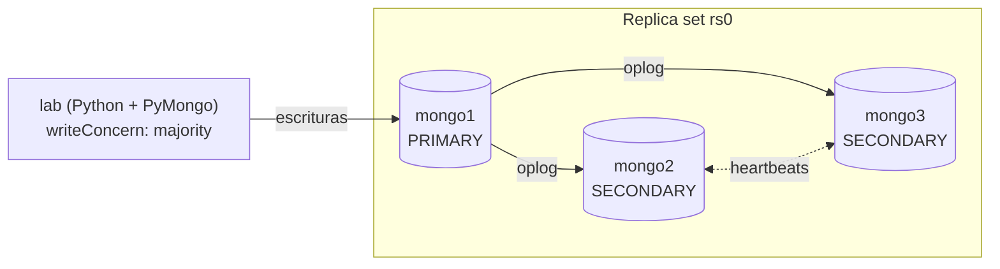

# Mongo Replica Lab

Laboratorio reproducible de **alta disponibilidad con MongoDB**: un replica set de 3 nodos en Docker y herramientas en Python que miden lo que realmente importa:

1. **¿Se replican todos los datos?** Carga 10.000 registros y compara cantidad y huella (hash) en cada nodo.
2. **¿Qué pasa si se cae el servidor principal?** Mata el primario mientras una aplicación escribe sin parar y mide cuánto tarda en elegirse uno nuevo, cuánto corte ve la aplicación y si se pierde algún dato.


## Arquitectura



- Tres nodos `mongo:7.0` con volúmenes propios, cada uno con su healthcheck.
- Un contenedor `init` configura el replica set **una sola vez** (si ya existe, no hace nada) y espera a que haya un primario.
- Un contenedor `lab` con la CLI en Python (`lab/replica_lab.py`) que se conecta al replica set completo o a cada nodo por separado.

## Cómo correrlo

Requisitos: Docker con Docker Compose. `make` es opcional: cada comando del `Makefile` se puede copiar y pegar.

```bash
cd mongo-replica-lab

make up          # docker compose up -d mongo1 mongo2 mongo3 && docker compose run --rm init
make status      # rol, salud y retraso de replicación de cada nodo
make load        # inserta 10.000 documentos y verifica los 3 nodos
make crash       # mata el primario de golpe mientras se escribe
make stepdown    # cambio de primario planificado (mantenimiento)
make down        # apaga todo y borra los volúmenes
```

Para conectarse con MongoDB Compass a un nodo puntual: `mongodb://localhost:27017/?directConnection=true` (los otros nodos están en los puertos `27018` y `27019`).

## Resultados

Corridas reales en Docker sobre Linux, con los tres nodos en la misma máquina. Los tiempos van a variar según el equipo, pero el comportamiento es el mismo.

### 1. Replicación de 10.000 registros

```text
$ make load
Insertando 10,000 documentos en lotes de 1000 (writeConcern: majority)...
Listo en 0.33 s (30,596 docs/s). run_id = e2158a4a

+--------------+-----------+------------+--------------+----------+
| Nodo         | Rol       | Documentos | Huella       | Completo |
+--------------+-----------+------------+--------------+----------+
| mongo1:27017 | PRIMARY   | 10,000     | 1899ec16689e | SÍ       |
| mongo2:27017 | SECONDARY | 10,000     | 1899ec16689e | SÍ       |
| mongo3:27017 | SECONDARY | 10,000     | 1899ec16689e | SÍ       |
+--------------+-----------+------------+--------------+----------+

Resultado: todos los nodos tienen exactamente los mismos datos ✔
```

La **huella** es un SHA-256 de los ids de los documentos de esa carga: si un nodo tuviera un documento de más, de menos o distinto, no coincidiría.

### 2. Caída abrupta del primario (`docker compose kill`)

Una aplicación escribe un documento cada 20 ms. A los 3 segundos se mata el contenedor primario sin apagado ordenado, como si se cortara la luz.

```text
$ make crash
Primario actual: mongo1:27017. Arranca una aplicación que escribe cada 20 ms...
Esperando la caída del primario (por ejemplo: docker compose kill mongo1)...
>> docker compose kill mongo1   (caída abrupta, sin apagado ordenado)
Caída detectada después de 84 escrituras confirmadas.
Nuevo primario: mongo2:27017. Sigo escribiendo 3 s más...

+-------------------------------+--------------+
| Métrica                       | Valor        |
+-------------------------------+--------------+
| Primario anterior             | mongo1:27017 |
| Nuevo primario                | mongo2:27017 |
| Tiempo hasta nuevo primario   | 7.99 s       |
| Corte máximo visto por la app | 10.05 s      |
| Escrituras confirmadas        | 205          |
| Escrituras con error          | 1            |
| Confirmadas que se perdieron  | 0            |
+-------------------------------+--------------+

Resultado: ninguna escritura confirmada se perdió ✔

>> Reincorporando mongo1 al replica set...
+--------------+-----------+-------+---------+---------------+
| Nodo         | Rol       | Salud | Retraso | Replica desde |
+--------------+-----------+-------+---------+---------------+
| mongo1:27017 | SECONDARY | OK    | 0.0 s   | mongo3:27017  |
| mongo2:27017 | PRIMARY   | OK    | 0.0 s   | -             |
| mongo3:27017 | SECONDARY | OK    | 0.0 s   | mongo2:27017  |
+--------------+-----------+-------+---------+---------------+
```

### 3. Cambio de primario planificado (`replSetStepDown`)

El mismo escenario, pero el primario cede su rol de forma ordenada, como se haría antes de un mantenimiento.

```text
$ make stepdown
Primario actual: mongo3:27017. Arranca una aplicación que escribe cada 20 ms...
81 escrituras confirmadas. Pidiendo al primario que ceda su rol...
Nuevo primario: mongo1:27017. Sigo escribiendo 3 s más...

+-------------------------------+--------------+
| Métrica                       | Valor        |
+-------------------------------+--------------+
| Primario anterior             | mongo3:27017 |
| Nuevo primario                | mongo1:27017 |
| Tiempo hasta nuevo primario   | 0.15 s       |
| Corte máximo visto por la app | 0.05 s       |
| Escrituras confirmadas        | 205          |
| Escrituras con error          | 0            |
| Confirmadas que se perdieron  | 0            |
+-------------------------------+--------------+

Resultado: ninguna escritura confirmada se perdió ✔
```

## Qué aprendí

- **Con `writeConcern: majority` no se perdió ninguna escritura confirmada**, ni siquiera matando el primario de golpe. Una escritura confirmada ya está en al menos 2 de los 3 nodos, así que sobrevive a la caída de cualquiera de ellos.
- **Una caída abrupta cuesta unos 10 segundos de corte.** Los secundarios no se enteran de inmediato de que el primario murió: esperan a que pase `electionTimeoutMillis` (10 s por defecto) sin recibir sus heartbeats y recién ahí convocan una elección. El "tiempo hasta nuevo primario" de la tabla da menos porque se mide desde que el script detecta la caída, unos 2 s después del `kill`; el corte es el mayor tiempo entre dos escrituras exitosas de la app. Bajar ese valor acelera la recuperación, pero aumenta las elecciones innecesarias en redes inestables.
- **Un cambio planificado es casi transparente:** 0,05 s de corte y ningún error. Por eso conviene hacer `stepDown` antes de reiniciar el primario por mantenimiento en lugar de apagarlo directamente.
- **Las escrituras con error no son datos perdidos.** El driver reintenta automáticamente una vez (`retryWrites`). Si el reintento también falla, la aplicación recibe una excepción y sabe que tiene que volver a intentar, así que el dato nunca se pierde en silencio.
- **El nodo caído se recupera solo:** al volver a levantarlo, entra como secundario y se pone al día copiando lo que se perdió desde el nuevo primario.

## Tests

Las funciones puras de la CLI (generación de datos, huella, cálculo de retraso, formato de tablas) tienen tests unitarios:

```bash
pip install -r requirements-dev.txt
python -m pytest -q tests
```

Además, el workflow de CI levanta el replica set real en GitHub Actions y corre la carga de 10.000 documentos y la prueba de caída del primario en cada push.

## Estructura

```
mongo-replica-lab/
├── docker-compose.yml           # 3 nodos + init + lab
├── scripts/
│   ├── init-replica-set.js      # rs.initiate idempotente
│   └── crash-primary.sh         # kill del primario + medición + reincorporación
├── lab/
│   ├── replica_lab.py           # CLI: status, primary, load, verify, failover
│   ├── requirements.txt
│   └── Dockerfile
├── tests/                       # pytest
└── Makefile
```
